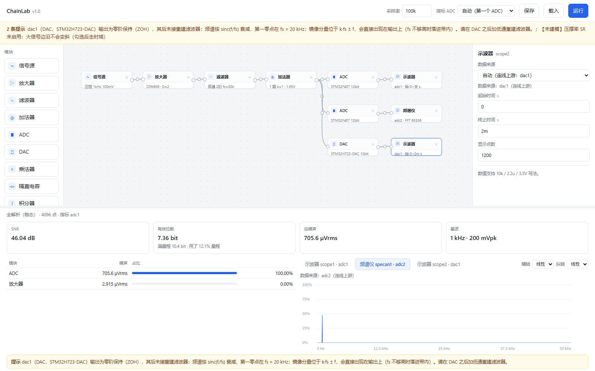

# ChainLab

[中文](README.md) | **English**

**Signal-chain budget & algorithm-capability simulator** — for students building analog front ends for embedded competitions (e.g. China's National Undergraduate Electronic Design Contest).

ChainLab answers one question fast: *given this analog chain, how much SNR / how many effective bits arrive at the ADC, and which block is to blame?*

It is **not** a SPICE replacement. No transistors, no parasitics, no transient accuracy. Runs in milliseconds so you can change a value and see the consequence immediately.

```
 source ─► amp ─► filter ─► adder ─► ADC ─┬─ scope
                                          └─ spectrum  (multiple ADCs / DACs allowed)
```

---

## Highlights

| | |
|---|---|
| **Two engines** | analytic (spectral, steady state) by default; time domain when a block has swing limits or slew rate enabled |
| **Noise budget** | per-block contribution, input/output referred, thermal + `en` + `in·Zsrc`, integrated only to `fs/2` |
| **Impedance layer** | `zout ∥ zin` per edge, real divider effects on gain and noise |
| **Filter designer** | Sallen-Key / MFB (TI equations), LP/HP/BP, 2–8th order cascades, E-series rounding, GBW correction |
| **Component mode** | type `10k`/`10n`, pick a standard topology, get the exact response from nodal analysis |
| **ADC/DAC** | 8 ADC and 5 DAC parts with datasheet-sourced specs; multiple instances; scope/specan picks its source from the wiring |
| **Honest limits** | every run prints what was *not* modelled |



---

## Quick start

```bash
pip install numpy pyyaml
python -m chainlab.ui          # opens http://127.0.0.1:8765/
```

Windows users can double-click `打开界面.bat` (it finds a suitable Python, offers to install the two dependencies, then starts the server).

Run a bundled example:

```bash
python -m chainlab.cli run chainlab/examples/amp8_chain.yaml --html out/report.html
```

Tests:

```bash
python chainlab/tests/test_m1.py        # 19 behavioural cases
python chainlab/tests/test_manual.py    # 5 datasheet cross-checks
python chainlab/tests/test_devices.py   # device table sanity
```

---

## What it models

**Blocks** — source (sine/square/triangle/AM/FM/noise, voltage or current), amplifier, filter, adder, multiplier, ADC, DAC, load, integrator, differentiator, DC block, transimpedance amp, VCO, PLL, scope, spectrum analyser, user algorithm (`.py`).

**Filters** — analytic design (Butterworth / Chebyshev I / II / Bessel) or direct component entry. Sallen-Key and MFB for low-pass and high-pass, single-stage MFB band-pass, cascades up to 8th order, E6…E96 snapping, optional op-amp GBW correction.

**Devices** — 24 op-amps, 2 multipliers, 8 ADCs, 5 DACs. Every number carries a `source:` field pointing at the datasheet page/table; `verified: false` marks anything not yet cross-checked.

---

## Documentation

| File | Contents |
|---|---|
| [`使用说明.md`](使用说明.md) | Full user manual (Chinese) |
| [`AGENTS.md`](AGENTS.md) | **AI / developer handbook** — architecture, invariants, extension recipes |
| [`docs/ARCHITECTURE.md`](docs/ARCHITECTURE.md) | Data flow, engines, noise model |
| [`docs/DEVICES.md`](docs/DEVICES.md) | Device YAML format |
| [`docs/TESTING.md`](docs/TESTING.md) | Test layout and how to add cases |
| [`CHANGELOG.md`](CHANGELOG.md) | Release notes |

---

## Known limitations

Documented rather than hidden — each run prints the relevant warnings:

- DAC output noise is not folded into the ADC noise budget
- Dual-channel ADC/DAC parts are modelled one channel per node
- Only the selected reference ADC gets an SNR/ENOB row (switchable, not side-by-side)
- Input resistance of the high-speed ADCs is not in their datasheets → treated as infinite
- Junction capacitance uses a single-pole IIR in the time-domain path (analytic path is exact)

---

## Repository layout

```
chainlab/            Python package (core engines, blocks, devices, UI server)
  core/              graph, spectral, timedomain, metrics, filter design, runner
  blocks/            one module per block type
  devices/           YAML device library
  ui/                single-file HTML UI + JSON API server
  tests/             test suites
datasheet/           README only — links to the vendor PDFs (not redistributed)
doc/                 使用说明 (user manual)
*.bat                Windows launchers
```

---

## License

MIT — see [LICENSE](LICENSE).

The vendor datasheets are **not** redistributed here (they are large and copyrighted). Every device value in `chainlab/devices/*.yaml` carries a `source:` field pointing at the exact table/page, so you can check any number against the manufacturer PDF; `datasheet/README.md` lists where to get them.
