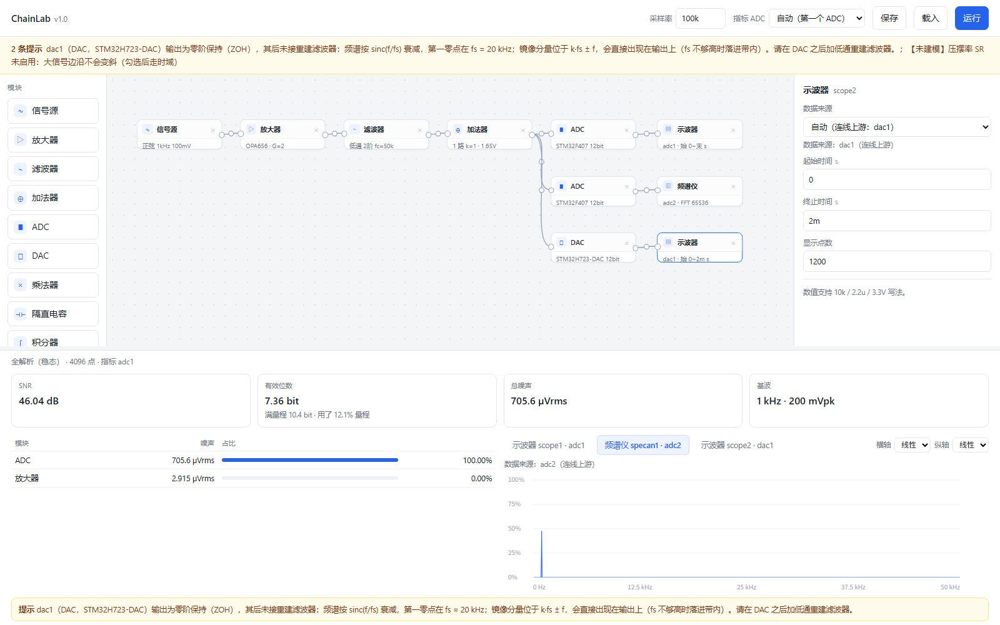

# ChainLab v1.0 · 信号链路预算与算法能力边界仿真

给电子设计竞赛的学生用的**信号链路预算工具**：把「源 → 放大 → 滤波 → 加法/乘法 → ADC → 算法」串成数据流图，毫秒级回答一个问题——

> 这条链路到 ADC 还剩多少信噪比？有效位数几位？噪声是谁贡献的？

**它不是电路仿真器**：不做晶体管级、不做寄生、不做波形精度。改一个参数立刻看到后果，这是它存在的理由。



## 快速开始

```bash
pip install numpy pyyaml
python -m chainlab.ui          # 浏览器打开 http://127.0.0.1:8765/
```

Windows 用户可直接双击 `打开界面.bat`（会自动找 Python、缺依赖时询问是否安装，然后启动服务）。

跑一个自带例子：

```bash
python -m chainlab.cli run chainlab/examples/amp8_chain.yaml --html out/report.html
```

## 它能做什么

| 能力 | 说明 |
|---|---|
| 两套引擎 | 默认解析（频域稳态）；有摆幅限制或启用压摆率时自动切时域 |
| 噪声预算 | 逐模块给出贡献，输入/输出参考、热噪声 + `en` + `in·Zsrc`，只积到 `fs/2` |
| 阻抗层 | 每条边 `zout ∥ zin`，分压同时影响增益与噪声 |
| 滤波器设计 | Sallen-Key / MFB（TI 公式），低通/高通/带通，2–8 阶级联，E 系列取整，可选 GBW 修正 |
| 按元件值 | 只填 `10k`/`10n`，选标准拓扑，节点法算出真实响应 |
| ADC/DAC | 8 种 ADC、5 种 DAC，可多实例；示波器/频谱仪按连线自动选观测点 |
| 诚实边界 | 每次运行都列出「这次没建模什么」 |

## 文档

| 文件 | 内容 |
|---|---|
| [`使用说明.md`](使用说明.md) | 完整用户手册 |
| [`AGENTS.md`](AGENTS.md) | **AI / 开发者手册**：架构、不变量、扩展步骤 |
| [`docs/ARCHITECTURE.md`](docs/ARCHITECTURE.md) | 数据流、两套引擎、噪声模型 |
| [`docs/DEVICES.md`](docs/DEVICES.md) | 器件 YAML 格式 |
| [`docs/TESTING.md`](docs/TESTING.md) | 测试布局与新增用例 |
| [`CHANGELOG.md`](CHANGELOG.md) | 版本说明 |

## 已知限制

- DAC 输出噪声不计入 ADC 噪声预算
- 双通道 ADC/DAC 每个节点只建模一个通道
- 指标表只显示所选基准 ADC（可切换，不并列多表）
- 高速 ADC 的输入电阻手册未给，按无穷大处理
- 电流源结电容的时域路径用单极点 IIR 近似（解析路径精确）

## 许可

MIT，见 [LICENSE](LICENSE)。

原厂手册体积大且有版权，**不随仓库分发**；每个器件数值在 yaml 的 `source:` 里写明了出处，`datasheet/README.md` 给了官方下载入口，可逐条核对。
